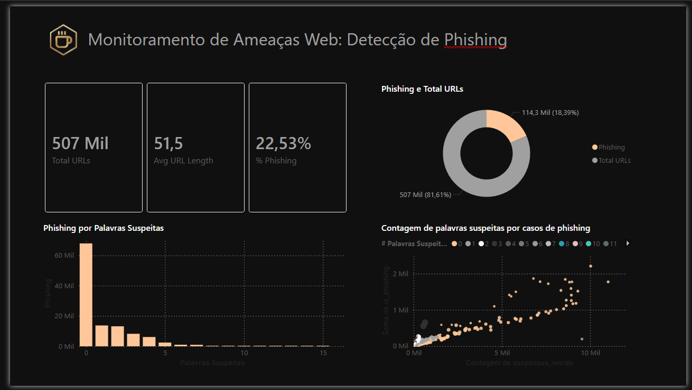
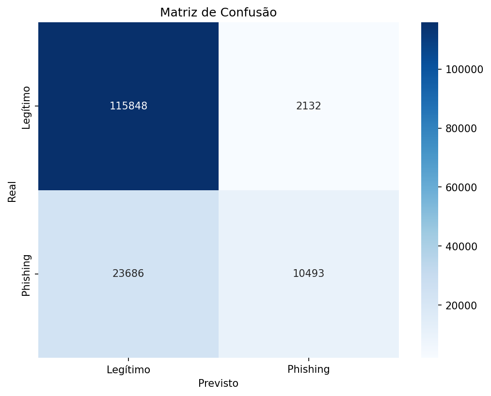

# 🛡️ Phishing Detection ML

> **Status:** Projeto acadêmico concluído. Este repositório é mantido como registro de estudo e não está em desenvolvimento ativo.

Este projeto foi desenvolvido como parte das atividades acadêmicas da FATEC, simulando a aplicação de Ciência de Dados em Segurança da Informação (Cybersecurity). O objetivo é construir um classificador capaz de detectar URLs maliciosas (Phishing) utilizando o algoritmo Naive Bayes.



## 🎯 Objetivos do Projeto (FATEC)



O desenvolvimento seguiu o pipeline de dados proposto, cobrindo as etapas de definição, tratamento, modelagem e visualização.

### 1. Definição do Tema
*   **Tema**: Detecção de Ameaças Cibernéticas (Phishing).
*   **Massa de Dados**: Dataset público "Phishing Site URLs" (Kaggle), contendo URLs reais classificadas como "good" (legítimas) ou "bad" (phishing).

### 2. Importação de Dados
Utilização da biblioteca `pandas` para carregar o dataset bruto.
```python
import pandas as pd
# Importação das informações originais para um dataframe
df = pd.read_csv('data/phishing_site_urls.csv')
```

### 3. Tratamento e Limpeza (Feature Engineering)
Para aplicar o algoritmo Naive Bayes, que exige dados numéricos, realizamos uma transformação profunda nos dados textuais (URLs).

**Tratativas realizadas (Antes -> Depois):**
*   **Remoção de Nulos**: Limpeza básica do dataset.
*   **Feature Engineering**: Criação de colunas numéricas a partir do texto da URL.
    *   `url_length`: Contagem de caracteres (URLs longas indicam risco).
    *   `has_ip`: (0/1) Se a URL usa IP ao invés de domínio.
    *   `has_at`: (0/1) Se contém '@', usado para camuflar destino.
    *   `dot_count`: Contagem de pontos (abuso de subdomínios).

### 4. Conexão com Power BI
Os dados tratados foram exportados para `data/phishing_site_urls_cleaned.csv`, pronto para importação no Power BI.
*   **Solução de Dashboard Proposta**: Painel de SOC (Security Operations Center) monitorando KPIs de ameaças bloqueadas e análise de risco por tamanho de URL.

### 5. Visualização de Dados (Python)
Utilização de `matplotlib` e `seaborn` para análise exploratória e validação de resultados.
*   **Matriz de Confusão**: Visualização gráfica dos erros e acertos do modelo.
*   **Gráficos de Dispersão/Histogramas**: Análise da distribuição do tamanho das URLs entre sites seguros e maliciosos.

### 6. Machine Learning: Naive Bayes
Implementação do algoritmo `GaussianNB` seguindo a rotina especificada:

1.  **Divisão Previsores/Classificadores**: Separação entre Features (`X`) e Label (`y`).
2.  **Ajuste Numérico**: Conversão de todas as features de texto para int/float.
3.  **Divisão Treino/Teste**: Utilização de `train_test_split` (70/30).
4.  **Criação do Modelo**: Instância do `GaussianNB`.
5.  **Previsões**: Geração de resultados com `.predict()`.
6.  **Avaliação**: Geração da Matriz de Confusão para medir % de acerto e Falsos Negativos.
7.  **Teste de Novo Valor**: Capacidade do modelo de receber uma nova URL e classificar em tempo real.

---

## 🚀 Como Executar


1.  **Instale as dependências**:
    ```bash
    pip install uv
    uv sync
    ```

2.  **Execute o pipeline**:
    ```bash
    python main.py
    ```
    *O script fará o carregamento, treinamento em episódios e gerará o gráfico `confusion_matrix.png`.*

---
*Projeto acadêmico focado em Data Science e Cybersecurity.*
